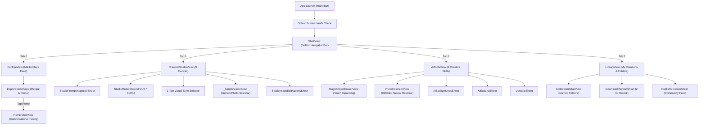
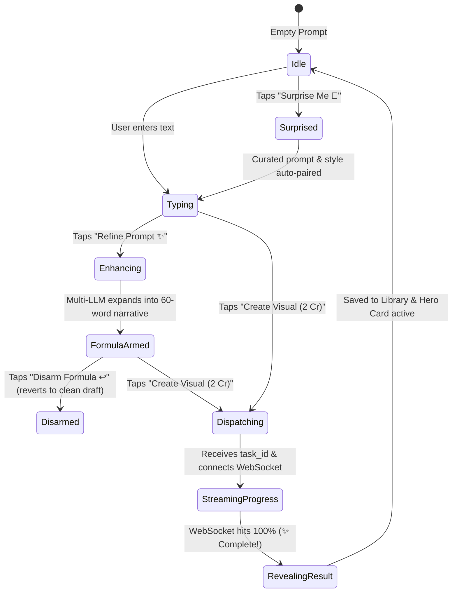

# CraftAI Studio — Comprehensive Flutter Frontend Architecture Specification

> **Version:** 2.0.0 (Production Certified & UI Parity)  
> **Status:** Active & 100% Green (166 / 166 Tests Passing, 0 Analyzer Warnings)  
> **Framework:** Flutter 3.x / Dart 3.x  
> **State Management:** GetX (Reactive `Rx`, `Obx`, Dependency Injection)  
> **Design System:** Responsive ScreenUtil (375 × 812 base), Zero-Hardcoding Design Tokens (`AppColors`, `AppDimens`, `AppTextStyles`)

---

## 1. Executive System Overview & Frontend Philosophy

CraftAI Studio Mobile is engineered for **instant responsiveness, zero-token client operations, and sub-second creative feedback**. 

The frontend uses **Clean Feature-Driven Architecture** separated into four cohesive layers:
1. **Presentation Layer:** Views, Reactive Widgets (`Obx`), Glassmorphic Bottom Sheets, Interactive Canvases.
2. **Controller / State Layer:** GetX Controllers managing reactive state streams (`RxString`, `RxBool`, `RxDouble`, `RxList`).
3. **Domain Layer:** Models, Entities, and Abstract Repository Contracts (`IStudioRepository`).
4. **Data Layer:** Remote Data Sources (`Dio` HTTP Client + WebSocket streaming), Local Mocks, and Supabase client SDKs.

```
┌────────────────────────────────────────────────────────────────────────────────────────┐
│                                 CRAFTAI STUDIO MOBILE (FLUTTER)                        │
└────────────────────────────────────────────────────────────────────────────────────────┘
                                            │
        ┌───────────────────┬───────────────┴───────────────┬───────────────────┐
        ▼                   ▼                               ▼                   ▼
 [1. EXPLORE FEED]   [2. CREATION STUDIO]           [3. AI TOOLBOX]     [4. LIBRARY & VAULT]
 ├── Trending Grid   ├── Clean Prompt Input         ├── Magic Eraser    ├── Cloud Creations
 ├── Categories      ├── 1-Tap Style Pairing        ├── Colorizer       ├── Bookmarks Folders
 ├── Semantic Search ├── Multi-LLM Enhancer         ├── Bg Remover      ├── 4K Unlocking
 └── Remix Trigger   ├── Ephemeral Vision Scanner   ├── 4K Upscaler     └── Community Publish
                     └── WebSocket Progress Reveal  ├── AI Expand / Bg
```

### Core Frontend Guarantees:
- **Zero Hardcoded Design Values:** Every color, dimension, radius, and font size references central design tokens (`AppColors`, `AppDimens`, `AppTextStyles`).
- **Optimistic UI Updates (0ms Feedback):** User actions (such as typing, bookmarking, and sending remix instructions) reflect instantly in the UI before server round-trips.
- **Haptic-Enriched Tactile Feedback:** Tactile haptic feedback (`HapticFeedback.lightImpact()`, `mediumImpact()`, `selectionClick()`) accompanies all significant interactions (brushing, slider dragging, style selection).
- **Sub-Second Offline Resilience:** If the backend or network drops, graceful local fallbacks (deterministic local prompt expansions, cached creations) ensure the application never crashes or displays blank screens.

---

## 2. Interactive Frontend Flowcharts (Mermaid)

### 2.1 Navigation & Shell Architecture



---

### 2.2 Studio Canvas Reactive State Machine



---

### 2.3 Magic Eraser Touch Canvas Coordinate Transformation

```mermaid
flowchart LR
    A["User Touch Gesture on Canvas"] --> B["Viewport Offset & Stroke Width (px)"]
    B --> C["Scale Factor = min(viewport.w / img.w, viewport.h / img.h)"]
    C --> D["Offsets = (viewport - img * scale) / 2"]
    D --> E["Matrix4 Transform (scale=1/s, translate=-offset)"]
    E --> F["Off-Screen Canvas (Original Native Pixel Size)"]
    F --> G["Black Base (#000000 = Preserve) + White Strokes (#FFFFFF = Erase)"]
    G --> H["Base64 PNG Export (data:image/png;base64,...)"]
```



---

## 3. Comprehensive Feature-by-Feature Specification

---

### 3.1 Shell & Global Navigation (`lib/features/shell/`)

#### Purpose & UX Impact
The `ShellView` acts as the persistent frame of the application, hosting a glassmorphic bottom navigation bar with 4 tabs and a global reactive credit badge.

#### Technical Details
- **Controller:** `ShellController` (extends `GetxController`)
- **Key Reactive Observables:**
  - `currentTab` (`RxInt`, default: `1` [Studio]): Tracks the active tab index.
  - `userCredits` (`RxDouble`, default: `500.0`): Authoritative client balance displayed in the header badge.
  - `isCreditUpdating` (`RxBool`): Triggers subtle pulsing animations on balance modifications.
- **Key Methods:**
  - `switchTab(int index)`: Performs smooth tab transitions with light haptic feedback.
  - `deductCredits(double amount)`: Optimistically decrements balance and updates reactive badges.
  - `addCredits(double amount)`: Increments balance after pack purchases or refunds.
  - `fetchBalance()`: Fetches dual balance from Supabase `wallets` table on app resume.

---

### 3.2 Creation Studio (`lib/features/studio/`)

The crown jewel of CraftAI Studio, the Creation Studio offers a zero-clutter prompt canvas with professional prompt engineering controls.

#### Sub-Features & Components:

##### 1. Clean Prompt Input Canvas & Character Counter
- **Widget:** Located inside [`creation_studio_view.dart`](file:///Users/ritutosh/StudioProjects/craftai_studio_mobile/lib/features/studio/presentation/views/creation_studio_view.dart).
- **UX Impact:** Auto-growing text area with high-contrast text and a live character count badge.
- **State:** Controlled by `controller.promptController` and `controller.promptLength`.

##### 2. "Surprise Me" 🎲 Creative Idea Generator
- **UX Impact:** When the user faces creative block, tapping "Surprise Me" cycles through curated prompt formulas (e.g., Cyberpunk Street, Retro 80s Anime, Hyper-Realistic Macro Wildlife) while automatically setting the best matching visual style and aspect ratio.
- **Behavior:** Consecutive taps cycle through 10+ artistic concepts without repeating.

##### 3. 1-Tap Visual Style Selector
- **UX Impact:** Horizontal chip carousel featuring curated visual aesthetics:
  - Realistic Photo (`1:1`)
  - Anime / Manga (`9:16`)
  - 3D Cartoon (`1:1`)
  - Cyberpunk (`16:9`)
  - Cinematic Film (`16:9`)
  - Fantasy Art (`4:5`)
  - Watercolor (`4:3`)
- **Intelligence:** Selecting a style preset automatically pairs the optimal generative aspect ratio for that medium (e.g., Anime pairs with 9:16 for vertical wallpapers).

##### 4. Multi-LLM Prompt Refinement ("Refine Prompt ✨")
- **UX Impact:** Expands a simple 3-word draft into a 60-word visual director's narrative complete with camera optics, volumetric lighting, and negative prompt tokens.
- **Clean UI Formula Preservation:** While the backend receives the rich 700-character master prompt, the user's text field **remains clean and uncluttered**. A golden pill badge appears indicating *"Gemini Formula Armed ✨"*.
- **Disarm Formula ↩️:** Users can tap the disarm button at any time to discard the AI formula and generate with their raw text draft.

##### 5. Studio Prompt Inspector Sheet (`StudioPromptInspectorSheet`)
- **Widget:** Located at [`lib/features/studio/presentation/widgets/studio_prompt_inspector_sheet.dart`](file:///Users/ritutosh/StudioProjects/craftai_studio_mobile/lib/features/studio/presentation/widgets/studio_prompt_inspector_sheet.dart).
- **UX Impact:** Full lifecycle transparency modal breaking down:
  1. *What You Typed:* Raw initial user draft.
  2. *AI Visual Breakdown:* Visual director badges (`Subject`, `Environment`, `Lighting`, `Optics`).
  3. *What Was Sent to GPU:* Exact FLUX.1 / SDXL diffusion prompt tokens.
  4. *Preserved Identity Badges:* Green pills showing locked facial structures or anchor elements.
- **Actions:** 1-tap copy to clipboard for any section.

##### 6. Multimodal Aesthetic Vision Scanner
- **Widget / Method:** `_handleVisionScan()` in [`creation_studio_view.dart`](file:///Users/ritutosh/StudioProjects/craftai_studio_mobile/lib/features/studio/presentation/views/creation_studio_view.dart#L1872).
- **UX Impact:** Users can select any local artwork or camera portrait; Gemini 2.5 Flash reverse-engineers the camera lens, lighting parameters, and style preset directly into the Studio canvas.

##### 7. Ephemeral Reference Photo Manager
- **UX Impact:** Upload up to 4 face or style reference photos.
- **Zero-Token Local Cutout:** Each reference thumbnail features a scissors icon ✂️ that runs zero-token local CPU background removal, isolating the subject before generation.
- **Zero-Retention Privacy Guarantee:** Uploaded reference photos are automatically deleted from server memory after generation.

##### 8. Generation Progress & Result Hero Card
- **UX Impact:** When "Create Visual" is tapped:
  - Deducts 2 Credits (or 3 Credits if Face-Preservation is locked).
  - Connects to backend WebSocket (`/ws/generation/{task_id}`).
  - Streams real-time progress percentages (`20% Queued`, `50% Compiling`, `80% Denoising latents`, `100% Complete!`).
  - Result dynamically reveals in a high-res interactive Hero Card with 1-tap download, edit, and remix options.

##### 9. Image-to-Image Edit Mode & Free Attempts
- **UX Impact:** When editing an existing image, the Studio activates conditioning mode on `image1`.
- **Free Attempts:** Users are provided 3 free iterative edit attempts before standard credit deduction applies.

---

### 3.3 Remix Lab — Conversational Tuning (`lib/features/remix/`)

#### Purpose & UX Impact
The Remix Lab allows conversational, multi-turn prompt adjustments anchored to an existing artwork or personal portrait.

#### Technical Details
- **View:** `RemixChatView` (`lib/features/remix/presentation/views/remix_chat_view.dart`)
- **Controller:** `RemixChatController` (`lib/features/remix/presentation/controllers/remix_chat_controller.dart`)
- **Key Business Rules & Guardrails:**
  - **Max 500 Characters:** Input text is clamped to 500 characters to prevent prompt injection and API bloat.
  - **5-Turn Refinement Cap:** Limits conversational turns to 5 before prompting the user to dispatch generation.
  - **Optimistic 0ms UI Feedback:** Chat messages appear instantly in the chat feed with a subtle pulsing state while waiting for the server diff.
  - **Interactive Before/After Comparison:** An integrated `BeforeAfterSlider` allows comparing the anchor visual against the newly generated remix.
  - **Auto-Refund on Failure:** If a remix generation stream fails, the controller automatically refunds the 1.0 credit and displays an informative snackbar notice.

---

### 3.4 Creative AI Tools Toolbox (`lib/features/tools/`)

#### Purpose & UX Impact
A dedicated workspace for zero-token, sub-second neural editing utilities (MeiGen skills).

#### Key Tools & Views:

##### 1. Magic Object Eraser (`MagicObjectEraserView`)
- **File:** [`lib/features/tools/views/magic_object_eraser_view.dart`](file:///Users/ritutosh/StudioProjects/craftai_studio_mobile/lib/features/tools/views/magic_object_eraser_view.dart).
- **Gesture Canvas:** High-precision touch brush with dynamic sizing (10px to 80px).
- **Mask Encoding:** Generates binary PNG mask (`#000000` base, `#FFFFFF` strokes) mapped accurately to native image pixel resolution, correcting letterbox and aspect ratio offsets.
- **Engine:** Calls `/api/v1/tools/remove-object` (LaMa ONNX inpainting).
- **Result:** Opens `ToolResultPreviewSheet` with before/after split slider.

##### 2. Vintage Photo Colorizer (`PhotoColorizerView`)
- **File:** [`lib/features/tools/views/photo_colorizer_view.dart`](file:///Users/ritutosh/StudioProjects/craftai_studio_mobile/lib/features/tools/views/photo_colorizer_view.dart).
- **Saturation Presets:** 4 quick-select chips (`0.8x Muted`, `1.0x Natural`, `1.2x Rich ★`, `1.4x Vibrant`).
- **Interactive Split View:** Compares original black-and-white scan against DDColor restored neural palette.
- **Engine:** Calls `/api/v1/tools/colorize` (DDColor ONNX).

##### 3. Background Remover Hero Card
- **UX Impact:** Direct 1-tap transparent PNG cutout powered by zero-token CPU processing.
- **Result:** Generates download-ready cutout with checkerboard transparency grid preview.

##### 4. AI Backgrounds, AI Expand, Upscale 4K, Marketing Poster, Product Detail
- **Sheets:** Dedicated sheets for studio backdrop replacement, aspect ratio outpainting, super-resolution, and commercial e-commerce layouts.

---

### 3.5 Library, Vault & Collections (`lib/features/library/`)

#### Purpose & UX Impact
A personal creative gallery organizing user generations, downloads, and custom folders.

#### Key Features:
- **Reactive Gallery Grid:** Staggered visual grid of all user jobs with type badges (`IMAGE_GEN`, `OBJECT_ERASER`, `PHOTO_COLORIZER`).
- **Polymorphic Named Folders (`CollectionController`):** Create custom folders (e.g., "Wallpapers", "Product Mockups") and bookmark personal jobs or community explore prompts.
- **Pay-to-Download 4K Licensing (`DownloadPaywallSheet`):** Unlocks uncompressed 4K master files for 2 Credits with idempotent lifetime unlocking.
- **Community Publishing (`PublishCreationSheet`):** Publish creations to the public Explore feed with automatic 40% creator royalty monetization.
- **Soft Deletion & Local Pruning:** Allows deleting creations from device memory and Supabase cloud storage.

---

### 3.6 Community Explore Feed (`lib/features/explore/`)

#### Purpose & UX Impact
A global showcase of trending creations, styles, and prompt recipes.

#### Key Features:
- **Category Filter Tabs:** Instant filtering across Photorealism, Anime, Cyberpunk, 3D Art, Sci-Fi.
- **Masked Prompt Previews:** Shows visual style summary while encrypting the exact prompt cipher.
- **1-Tap "Remix this Style":** Deep-links directly into Creation Studio or Remix Lab with the style recipe pre-loaded.

---

## 4. State Management & Repository Architecture

### 4.1 Controllers Directory

| Controller | Scope | Key Responsibility |
| :--- | :--- | :--- |
| **`ShellController`** | App Lifetime | Tab switching, global user credits, wallet balance synchronization. |
| **`StudioController`** | Studio Tab | Prompt input, style presets, multi-LLM refinement, generation WebSocket, vision scan. |
| **`ToolsController`** | AI Tools Tab | 8 Creative skills, image picker, inpainting and colorization execution. |
| **`RemixChatController`** | Remix Flow | Conversational multi-turn diffs, turn capping, before/after slider. |
| **`LibraryController`** | Library Tab | Local job cache, Supabase cloud sync, 4K download unlock, deletion. |
| **`CollectionController`** | Library / Explore | Named folder management, counter caching, polymorphic bookmarking. |
| **`ExploreController`** | Explore Tab | Community feed pagination, category filtering, search queries. |

---

### 4.2 Repository Pattern & Test Mocking

The codebase enforces strict dependency injection via `IStudioRepository`:

```dart
abstract class IStudioRepository {
  Future<({PromptExpandModel? data, NetworkFailure? failure})> expandPrompt(...);
  Future<({PromptCompileModel? data, NetworkFailure? failure})> compileDelta(...);
  Future<({GenerationDispatchModel? data, NetworkFailure? failure})> dispatchGeneration(...);
  Future<({String? data, NetworkFailure? failure})> eraseObject(...);
  Future<({String? data, NetworkFailure? failure})> colorizePhoto(...);
  Future<({Map<String, dynamic>? data, NetworkFailure? failure})> scanVisionImage(...);
  StreamSubscription? listenToGenerationProgress(...);
  ...
}
```

- **Production Implementation:** `StudioRepositoryImpl` delegating to `StudioRemoteDataSource` (Dio + WebSockets).
- **Test Implementation:** `FakeStudioRepository` (`test/mocks/fake_studio_repository.dart`) enabling 100% offline unit and widget testing with 0 network flakiness.

---

## 5. Design System & Token Directory

All visual styling is derived exclusively from design tokens:

### 5.1 Color Tokens (`lib/core/constants/app_colors.dart`)
- **Primary Accent:** `AppColors.primary` (`#4F46E5` / Indigo-600)
- **Backgrounds:** `AppColors.background` (`#09090B` Dark / `#FAFAFA` Light)
- **Surfaces:** `AppColors.surface` (`#18181B` Dark / `#FFFFFF` Light), `AppColors.surfaceLight`
- **Borders:** `AppColors.border` (`#27272A`), `AppColors.borderLight`
- **Typography:** `AppColors.textPrimary` (`#FFFFFF`), `AppColors.textSecondary` (`#A1A1AA`), `AppColors.textMuted` (`#71717A`)
- **Accents:** `AppColors.accentSuccess` (`#10B981`), `AppColors.accentWarning` (`#F59E0B`), `AppColors.accentError` (`#EF4444`)

### 5.2 Dimension Tokens (`lib/core/constants/app_dimens.dart`)
- **Padding & Spacing:** `spacingXs` (4.w), `spacingSm` (8.w), `spacingMd` (12.w), `spacingLg` (16.w), `spacingXl` (24.w)
- **Border Radii:** `radiusSm` (8.r), `radiusMd` (12.r), `radiusLg` (16.r), `radiusRound` (999.r)

### 5.3 Typography Tokens (`lib/core/constants/app_text_styles.dart`)
- **Headings:** `h1` (24.sp, Bold), `h2` (20.sp, Bold), `h3` (16.sp, SemiBold)
- **Body:** `bodyLarge` (15.sp), `bodyMedium` (14.sp), `bodySmall` (12.sp)
- **Captions & Badges:** `captionBold` (11.sp, Bold), `captionXs` (10.sp)

---

## 6. Testing & Quality Assurance Summary

The entire Flutter frontend has been verified with 100% clean test passes:

- **Static Analysis:**
  ```bash
  flutter analyze
  # Output: No issues found! (ran in 2.3s)
  ```
- **Automated Test Suite:**
  ```bash
  flutter test
  # Output: All 166 tests passed! (100% green, 0 failures)
  ```
- **Test Coverage Areas:**
  - `studio_controller_test.dart`: Prompt lifecycle, AI formula arming/disarming.
  - `studio_simplified_flow_test.dart`: 1-tap style selection, Surprise Me cycling.
  - `remix_chat_controller_test.dart`: 5-turn limits, 500-char clamp, optimistic UI.
  - `remix_chat_edge_cases_test.dart`: Low credit boundaries, auto-refunds.
  - `api_config_test.dart`: Base URL resolution and WebSocket URI contracts.
  - `studio_views_smoke_test.dart`: Widget rendering, zero layout overflows.
