# CraftAI Studio — Production Architecture, System Flow & QA Test Matrix

> **Document Status:** Active Production Specification (Phase 1 Live)  
> **Document Purpose:** 100% accurate, zero-fluff system flow, database schema, design system tokens, and QA verification matrix reflecting the actual codebase.  
> **Target Reviewers:** QA Engineers, Mobile Engineers, Backend Engineers.  
> **Target Tech Stack:** Flutter Mobile (iOS & Android) • FastAPI Gateway (Python 3.11) • Supabase (PostgreSQL 15+, Auth, Storage, Realtime, pgvector) • Razorpay (INR) / Stripe (USD) • Serverless GPU Workers.  
> **Verification Status:** **256 / 256 Automated Tests Passing** • `flutter analyze`: **0 Issues Found**.

> [!WARNING]
> **CRITICAL QA NOTICE ON IMAGE GENERATION QUALITY & FREE TIER ENGINES:**  
> Currently, the platform operates on **free community AI generation models / free tier inference endpoints** (such as Pollinations.ai / open community fallbacks) because paid commercial API keys (e.g., Black Forest Labs paid FLUX Pro API, Fal.ai, or Replicate dedicated GPU clusters) are **NOT yet configured**.  
> **Key QA Guidelines:**
> 1. **Visual Fidelity Limitation:** Free model outputs may appear basic, lower fidelity, or aesthetically sub-optimal. This is an **expected third-party provider limitation**, NOT an application defect.
> 2. **Primary QA Focus:** QA testing must strictly validate **functional and technical flows**: UI responsiveness, progress loaders, WebSocket/HTTP generation pipelines, accurate wallet credit deduction, private Cloud Library saving, Remix Chat Lab iteration, and Tools Hub features.
> 3. Studio-grade 8K photorealism will activate automatically once production paid enterprise keys are attached.

---

# PART I: CORE SYSTEM ARCHITECTURE & PRODUCTION RULES

## 1. System Overview

CraftAI Studio is an AI Creation Studio and Curated Prompt Marketplace mobile application built with Flutter, backed by a FastAPI microservices gateway and Supabase PostgreSQL.

The platform operates on a **Frictionless Creation** model:
1. **Creation & In-App Browsing are Free:** Users generate, iterate, and view creations inside their in-app Cloud Library without upfront subscription paywalls.
2. **Monetization at Intent:** Lossless 4K unwatermarked master file downloads to local device storage cost **flat 2 Credits** (~₹17 INR / $0.20 USD). Re-downloads are **100% free (idempotent)**.
3. **Marketplace & Royalties:** Creators publish community prompts to Explore. When another user remixes an artwork in the **Remix Chat Lab**, the original creator receives a royalty credit.
4. **Encrypted DRM:** Master prompts are encrypted server-side with AES-256-GCM. Public cards display aesthetic abstracts only, and clipboard copying is blocked.
5. **UI/UX Integrity:** Single-icon policy across all buttons (no emoji + Material icon mixing), Pinterest-style filter radii (`12.r` / `14.r`), and 1:1 action-to-intent routing.

---

## 2. Production Credit & Pricing Structure (Phase 1 Live)

> [!IMPORTANT]
> **QA Note on Pricing:** Phase 1 uses **clear, transparent, model-based credit pricing** displayed directly on the UI. The token/word-count dynamic scoring formula is slated for Phase 2 (see [Section 9](#9-phase-2--future-roadmap)).

### Current Live Credit Costs:

| Operation | Model / Tool | Billed Credits | UI Button Display | QA Verification Point |
| :--- | :--- | :---: | :--- | :--- |
| **Fast Generation** | FLUX.1 Schnell | **2 Credits** | `Generate • 2 Cr` | Deducts exactly 2.00 credits from wallet. |
| **Fast Turbo** | SDXL Turbo | **2 Credits** | `Generate • 2 Cr` | Deducts exactly 2.00 credits. |
| **Pro Generation** | FLUX.1 Pro | **4 Credits** | `Generate • 4 Cr` | Deducts exactly 4.00 credits. |
| **Face-Lock Character** | InstantID (Apache 2.0) | **4 Credits** | `Generate • 4 Cr` | Requires 3 facial reference photos. |
| **Community Remix** | Dedicated Remix Chat Lab | **1 Credit** | `Generate Remix (1 Credit)` | Deducts 1.00 credit; triggers creator royalty. |
| **Download 4K Master** | Lossless PNG export | **2 Credits** | `Download 4K (2 Cr)` | First download charges 2 Cr; re-download = **0 Cr**. |
| **AI Background Remover**| Alpha Matte Isolation | **1 Credit** | `Remove Background (1 Cr)`| Pre-loads selected library image. |
| **Creative Tools Hub** | Inpaint, Grab, Upscale | **1–2 Credits** | Dynamic per tool | Validates sufficient balance before task. |

---

## 3. The 9 Live AI Creative Tools

Located in `lib/features/tools/views/`:

1. **AI Background Remover (`background_remover_view.dart`):**  
   Isolates foreground subjects and generates transparent PNGs. Can be launched directly from the Tools Hub or pre-loaded with an existing creation via the Library card action sheet.
2. **Magic Object Eraser (`magic_object_eraser_view.dart`):**  
   Brush-based inpainting tool to erase unwanted objects, wires, or people from photos.
3. **Magic Grab (`magic_grab_view.dart`):**  
   Detects and cuts out subjects from an image, allowing them to be moved or exported independently.
4. **AI Expand (`ai_expand_view.dart` / `ai_expand_sheet.dart`):**  
   Outpainting tool that extends image borders seamlessly in 1:1, 16:9, or 9:16 aspect ratios.
5. **Photo Colorizer (`photo_colorizer_view.dart`):**  
   Restores vintage or black-and-white photos with neural colorization.
6. **AI Backgrounds (`ai_backgrounds_view.dart`):**  
   Replaces product or portrait backgrounds with studio-grade 3D environments.
7. **Marketing Poster (`marketing_poster_view.dart`):**  
   Composes AI imagery with commercial typography for social ads and marketing banners.
8. **Product Studio (`product_detail_view.dart`):**  
   E-commerce product staging with realistic shadows and studio lighting.
9. **AI Upscale (`upscale_view.dart`):**  
   Lossless 2K to 4K super-resolution upscaler with texture enhancement.

---

## 4. End-to-End User Flows

```mermaid
flowchart TD
    subgraph Flow1["1. Creation Studio Flow (Free In-App Storage)"]
        A1["User Enters Idea / Prompt"] --> A2["Select AI Assistant: Gemini 2.5 / Groq / Claude"]
        A2 --> A3["Tap 'Polish' (1-Tap Magic Expansion)"]
        A3 --> A4["Select Model: Flux Schnell (2 Cr) / Flux Pro (4 Cr)"]
        A4 --> A5["FastAPI Gateway Dispatches to GPU Worker"]
        A5 --> A6["Image Saved to User Private Cloud Library"]
    end

    subgraph Flow2["2. Dedicated Remix Chat Lab (RemixChatView)"]
        B1["User Taps 'Remix in Lab' on Explore Card"] --> B2["Direct Navigation to RemixChatView"]
        B2 --> B3["Locked Anchor Image Preview + Creator Info"]
        B3 --> B4["Quick Modifiers: Tap to Add, Tap to Remove (Toggle)"]
        B4 --> B5["User Types Modification Delta"]
        B5 --> B6["Generate Remix (1 Credit Deducted)"]
        B6 --> B7["increment_creator_royalty RPC Credits Original Creator"]
    end

    subgraph Flow3["3. Pay-to-Download 4K Master File"]
        C1["Open Image in Cloud Library"] --> C2["Tap 'Download 4K Master'"]
        C2 --> C3{"is_download_unlocked == TRUE?"}
        C3 -- "Yes (Re-Download)" --> C4["Serve 15-Minute Signed URL (0 Cr / Free)"]
        C3 -- "No (First Time)" --> C5["Deduct 2 Credits via PostgreSQL ACID Lock"]
        C5 --> C6["Set is_download_unlocked = TRUE"]
        C6 --> C4
        C4 --> C7["Download Lossless PNG to Device Gallery"]
    end
```



---

# PART II: DESIGN SYSTEM & VISUAL INTEGRITY

## 5. Live Color Palette & Design Tokens

> **Source of Truth:** `lib/core/constants/app_colors.dart` & `lib/core/theme/app_theme.dart`  
> **Font Family:** `Inter`, sans-serif (Google Fonts)

### 5.1 Constant Brand Accents (Persistent across all themes)
* **Primary Brand:** `#6366F1` (Cosmic Indigo — CTA Buttons, Active Tabs, Highlights)
* **Secondary Brand:** `#8B5CF6` (Cyber Violet — AI Badges, Glow Borders)
* **VIP / Royalty:** `#A855F7` (Pro Tier, Creator Highlights)
* **Cyan Accent (Copilot):** `#06B6D4` (Copilot Tools, Active Quick Modifier Chips)
* **Success:** `#10B981` (Emerald — Wallet Balance Additions, Completed Tasks)
* **Warning:** `#F59E0B` (Amber — Credit Warnings, Pending Status)
* **Error / Destructive:** `#EF4444` (Crimson — Failed Jobs, Delete Actions)

### 5.2 Signature AI Cosmic Gradient
```css
background: linear-gradient(135deg, #8B5CF6 0%, #6366F1 50%, #06B6D4 100%);
```

### 5.3 Theme Presets (Light vs. Dark)

| Semantic Element | Light Mode: **Luminous Aurora** (Default) | Dark Mode: **Deep Obsidian** (Default) |
| :--- | :--- | :--- |
| **Canvas Background** | `#F8FAFC` (Slate 50) | `#0B0D14` (Deep OLED) |
| **Surface / Card** | `#FFFFFF` | `#161B26` |
| **Elevated Surface (Modals)** | `#FFFFFF` | `#121622` |
| **Muted Surface (Inputs/Chips)**| `#F1F5F9` | `#1F2636` |
| **Border / Dividers** | `#E2E8F0` (Slate 200) | `#283245` |
| **Subtle Border** | `#EEF2F6` | `#1C2230` |
| **Glass Surface** | `rgba(255, 255, 255, 0.73)` | `rgba(22, 27, 38, 0.80)` |
| **Glass Border** | `rgba(99, 102, 241, 0.20)` | `rgba(255, 255, 255, 0.18)` |
| **Primary Text** | `#0F172A` (Slate 900) | `#F8FAFC` (Slate 50) |
| **Secondary Text** | `#475569` (Slate 600) | `#94A3B8` (Slate 400) |
| **Muted Text** | `#64748B` (Slate 500) | `#64748B` (Slate 500) |
| **Tertiary / Disabled** | `#94A3B8` (Slate 400) | `#475569` (Slate 600) |

### 5.4 Geometry & Radii
* **Pinterest Filter & Quick Modifier Chips:** `12px` - `14px` (`12.r` / `14.r`)
* **Artwork Cards & Modal Containers:** `16px` - `20px` (`16.r` / `20.r`)
* **Buttons & Action Bars:** `12px` - `16px` (`12.r` / `16.r`)
* **Floating Pills & Navigation FABs:** `9999px` (Full Rounded Pill)

---

## 6. Single-Icon & Visual Integrity Policy

> Enforced automatically by contract test `test/core/ui_ux_integrity_test.dart`

1. **Zero Double-Icon Duplication:**  
   Buttons must NEVER combine an `icon: Icon(...)` widget with an emoji in the text label.
   - ❌ `icon: Icon(Icons.bolt)` + `'⚡ Remix in Studio'` -> Forbidden (double bolt)
   - ❌ `icon: Icon(Icons.auto_awesome)` + `'Generate ✨'` -> Forbidden (double sparkle)
   - ✅ Single Material icon OR clean text.
2. **Action-to-Intent 1:1 Routing:**  
   Every CTA button label must strictly represent the destination screen:
   - "Remix in Lab" strictly navigates to `RemixChatView(anchorImageUrl: ..., initialPrompt: ...)`.
   - "Remove Background" on a library card strictly navigates to `BackgroundRemoverView(initialImagePath: ...)`.
3. **No Dead Callbacks:**  
   Zero empty `onPressed: () {}` callbacks in production UI code.

---

# PART III: DATABASE SCHEMA & PAYMENT INTEGRATION

## 7. PostgreSQL Schema & RLS Governance

Database is hosted on Supabase and optimized for low-latency queries:
- **InitPlan Subquery Optimization:** All RLS policies use `((SELECT auth.uid()) = user_id)` to execute once per query instead of per row.
- **Covering B-Tree Indexes:** All foreign keys are indexed to prevent sequential table scans.
- **Zero Duplicate Indexes:** Automatic unique constraints manage deduplication.

### Live Table Schema:

| Table | Purpose | Primary Keys & Key Foreign Keys | Live RLS Rule |
| :--- | :--- | :--- | :--- |
| `characters` | InstantID face-lock profiles | `id (PK)`, `user_id -> auth.users` | User manages own characters |
| `explore_prompts` | Community marketplace feed | `id (PK)`, `author_id`, `user_id` | Public can view active; author manages own |
| `jobs` | Generation tasks & 4K unlock ledger | `id (PK)`, `user_id`, `character_id`, `remixed_from_prompt_id` | User views, inserts, updates own jobs |
| `collections` | User bookmark folders | `id (PK)`, `user_id -> auth.users` | User manages own collections |
| `collection_items` | Junction table for bookmarks | `id (PK)`, `collection_id`, `job_id`, `explore_prompt_id`, `user_id` | User manages own items |
| `wallets` | Realtime balance (free, purchased, royalties) | `id (PK)`, `user_id (UNIQUE)` | User views own wallet; atomic RPCs update |
| `credit_packages` | Dynamic pricing catalog (INR / USD) | `id (PK)`, `package_id (UNIQUE)` | Public views active packages |
| `payment_transactions` | Payment audit records | `id (PK)`, `user_id`, `package_id` | User views own transactions |
| `wallet_ledger` | Itemized passbook | `id (PK)`, `user_id -> auth.users` | User views own ledger |
| `remix_sessions` | Multi-turn remix chat sessions | `id (PK)`, `user_id`, `remixed_from_prompt_id` | User manages own sessions |
| `categories` | Category list with smart keywords | `id (PK)`, `slug (UNIQUE)` | Public views active categories |
| `royalty_transactions` | Creator earnings financial log | `id (PK)`, `buyer_user_id`, `creator_user_id`, `prompt_id` | Buyer & creator view relevant logs |

### Live RPC Stored Procedures:
1. `public.fulfill_credit_purchase(...)`: Atomically fulfills payment, credits `purchased_balance`, records `payment_transactions`, and logs `wallet_ledger` in a single ACID transaction.
2. `public.increment_creator_royalty(...)`: Atomically credits creator royalties and records passbook entries when a community artwork is remixed.
3. `public.toggle_prompt_like(...)`: Atomic counter increment/decrement preventing race conditions on likes.

---

## 8. Dynamic Payment Packages (Razorpay & Stripe)

Managed dynamically via `public.credit_packages` in Supabase:

| Package ID | Package Name | Price (INR ₹) | Price (USD $) | Base Credits | Bonus Credits | Total Credits |
| :--- | :--- | :---: | :---: | :---: | :---: | :---: |
| `pack_starter_99` | Starter Pack | **₹99.00** | $1.99 | 80 Cr | +20 Cr Bonus | **100 Credits** |
| `pack_creator_249` | Creator Pack (Popular) | **₹249.00** | $4.99 | 250 Cr | +50 Cr Bonus | **300 Credits** |
| `pack_studio_799` | Studio Pro Pack | **₹799.00** | $14.99 | 800 Cr | +200 Cr Bonus | **1000 Credits** |

---

# PART IV: FUTURE ROADMAP & PHASE 2

## 9. Phase 2 — Future Roadmap (Not in Current Production)

> [!NOTE]
> The following items are architectural proposals planned for **Phase 2**. QA engineers should **NOT** test or expect these in the current Phase 1 release:

1. **Dynamic Word-Count / Token Pricing Formula:**
   - *Phase 2 Concept:* `Compute = Model Base + Word Delta (30-80 words = +1 Cr) + Resolution Delta + Sampling Steps Delta`.
   - *Current Phase 1 Status:* Inactive. Phase 1 uses flat, predictable model-based costs (2 Cr Flux Schnell, 4 Cr Flux Pro, 1 Cr Remix).
2. **Dedicated AI Video Suite:**
   - *Phase 2 Concept:* Image-to-Video (I2V), Text-to-Video (T2V), LivePortrait Face Motion, 3D Orbit Camera controls.
   - *Current Phase 1 Status:* Inactive. Current release focuses strictly on Image Studio, Remix Lab, and the 9 Creative Tools.
3. **Automated Stripe Connect Payouts Portal:**
   - *Phase 2 Concept:* Self-serve creator KYC onboarding and automatic Stripe Connect bank payouts for accumulated royalties.
   - *Current Phase 1 Status:* Manual creator payout requests logged via support/admin.

---

# PART V: QA VERIFICATION MATRIX & TEST CHECKLIST

## 10. QA Step-by-Step Test Scenarios

> [!IMPORTANT]
> **QA Evaluation Standard on Free-Tier Generation Models:**  
> Test cases must be evaluated on **functional execution and technical reliability** (HTTP 200 / WebSocket handshake, correct wallet credit deduction, loader animation, image rendering, and Cloud Library persistence).  
> **Do NOT fail test cases based on image realism or aesthetic flaws**, as free community generation engines are active in Phase 1 testing. High-fidelity photorealism is tied to commercial enterprise keys arriving at production launch.

### Test Suite 1: UI/UX Integrity & Single-Icon Policy
* **TC-UI-01: Zero Icon Duplication**
  * *Action:* Inspect buttons across Studio (`Generate`, `Polish`), Explore (`Remix in Lab`), Remix, and Tools (`Grab Subject`, `Erase Object`).
  * *Pass Criteria:* No button mixes Material icons with emojis. Each button displays a single clean icon or text.
* **TC-UI-02: Explore Remix CTA Direct Routing**
  * *Action:* In Explore feed, tap an image to open detail view. Tap "Remix in Lab".
  * *Pass Criteria:* Directly opens `RemixChatView` with the image pre-loaded as the anchor thumbnail. Does NOT switch shell tabs to Prompt to Image.
* **TC-UI-03: Explore Detail Secondary Row Overflow**
  * *Action:* Open Explore Image Detail view on small screens (359px width).
  * *Pass Criteria:* Exactly 3 buttons (`Save`, `Use Ref`, `Share`) display without RenderFlex overflow.
* **TC-UI-04: Pinterest Filter Radius**
  * *Action:* Inspect the category filter bar at the top of Explore feed.
  * *Pass Criteria:* Chips have rounded corners matching `12.r` / `14.r`, aligned with the search bar.
* **TC-UI-05: Floating FAB Menu Purity**
  * *Action:* Tap the floating Action Button on Home Shell.
  * *Pass Criteria:* Expands with strictly 3 primary items (Prompt to Image, AI Tools, My Cloud Library). Zero background shadow artifacts.

---

### Test Suite 2: Dedicated Remix Chat Lab (`RemixChatView`)
* **TC-RMX-01: Quick Modifier Toggle On/Off**
  * *Action:* In `RemixChatView`, tap "+ Cyberpunk Neon".
  * *Pass Criteria:* Chip displays primary border, tint, and checkmark. Prompt input appends `+ Cyberpunk Neon`. Tap again: chip unselects and text is cleanly removed.
* **TC-RMX-02: Duplicate Modifier Prevention**
  * *Action:* Rapidly tap the same modifier chip multiple times.
  * *Pass Criteria:* The modifier is never appended twice in the prompt.
* **TC-RMX-03: Remix Generation & Credit Deduction**
  * *Action:* Type a prompt change and tap `Generate Remix (1 Credit)`.
  * *Pass Criteria:* Exactly 1 credit is deducted from wallet balance. Progress indicator displays. Output renders in chat.
* **TC-RMX-04: Creator Royalty Trigger**
  * *Action:* Complete a remix of another user's public artwork.
  * *Pass Criteria:* Original creator's `earned_royalty_balance` increments via `increment_creator_royalty`.

---

### Test Suite 3: Creative Tools Hub & Library Pre-Loading
* **TC-TOOL-01: Library Remove Background Pre-Loading**
  * *Action:* In Cloud Library, tap the three-dots menu on an image card. Tap "Remove Background".
  * *Pass Criteria:* Opens `BackgroundRemoverView` with the selected image automatically pre-loaded on the canvas.
* **TC-TOOL-02: Library Remix in Lab Direct Navigation**
  * *Action:* From Library image edit actions sheet, tap "Remix in Lab (Chat)".
  * *Pass Criteria:* Opens `RemixChatView` with the library generation loaded as the anchor image.
* **TC-TOOL-03: 4K Master Download Idempotency**
  * *Action:* Download an unlocked 4K image, close app, reopen, and tap download again.
  * *Pass Criteria:* First download deducts 2 credits; second download deducts 0 credits.

---

### Test Suite 4: Wallet & Payment Transactions
* **TC-PAY-01: Dynamic Package Loading**
  * *Action:* Open Wallet / Top-Up sheet.
  * *Pass Criteria:* Packages load dynamically from `credit_packages` table showing correct INR (₹) prices, credits, and bonus chips.
* **TC-PAY-02: Atomic Purchase Fulfillment**
  * *Action:* Complete a test purchase.
  * *Pass Criteria:* `fulfill_credit_purchase` RPC updates wallet balance and creates a passbook entry in `wallet_ledger`.
* **TC-PAY-03: Purchased vs. Free Balance Separation**
  * *Action:* Check wallet balance card.
  * *Pass Criteria:* Displays purchased credits vs. free promotional credits clearly.

---

## 11. Automated Test Verification Commands

The following commands must pass before any QA sign-off:

```bash
# 1. Static analysis (Must return "No issues found!")
flutter analyze

# 2. Automated UI/UX integrity contract tests (3 contracts: zero emoji duplication, remix routing, zero dead callbacks)
flutter test test/core/ui_ux_integrity_test.dart

# 3. Full test regression suite (256/256 tests must pass)
flutter test
```
