# CraftAI Studio — Production Architecture, System Flow & QA Test Matrix (Version 2.0)

> **Document Classification:** Enterprise Production Architecture, System Flow & QA Test Matrix  
> **Document Purpose:** Complete architectural specification, live business rules, database schema, design system tokens, and end-to-end verification checklist for Engineering, QA, and Product teams.  
> **Target Reviewers:** QA Engineers, Mobile Engineers, Backend Engineers, Solutions Architects.  
> **Target Tech Stack:** Flutter Mobile (iOS/Android) • Next.js 15 Web Platform • FastAPI Gateway (Python 3.11) • Supabase (PostgreSQL 15+, Auth, Storage, Realtime, pgvector) • Redis Task Queue • Razorpay / Stripe Payments • Serverless GPU Workers.  
> **Automated Test Suite Status:** **256 / 256 Tests Passing** • `flutter analyze`: **0 Issues Found**.

---

# PART I: PRODUCT & BUSINESS FOUNDATION

## 1. Executive Summary & Value Proposition

**CraftAI Studio** is a next-generation AI Image & Video Creation Studio and Curated Prompt Marketplace deployed across **Flutter Mobile** (iOS & Android) and **Next.js 15 Web Platform**, powered by a high-throughput **FastAPI Gateway** and **Supabase PostgreSQL**.

### Industry Problems Solved:
1. **Upfront Paywalls:** Demanding credits or subscriptions before a user sees output causes an **85%+ user drop-off**.
2. **Unprotected Creator IP:** Master prompt engineers invest hours tuning prompts only to have them scraped from public feeds without attribution or compensation.
3. **Double-Icon & UI Clutter:** Mobile AI apps frequently suffer from visual clutter, inconsistent navigation, and redundant emoji/icon button labels.

### The Creator Flywheel Model:
* **Frictionless In-App Creation:** Users generate, iterate, and curate creations in their private Cloud Library for free.
* **Monetization at Intent (Rule 1):** Unlocking and exporting full-resolution, lossless 4K master files to local storage costs **flat 2 Credits ($0.20 / ~₹17 INR)**. Re-downloads are **100% free (idempotent)**.
* **Passive Creator Royalties (Rule 2):** Creators publish encrypted creations to the Explore feed and earn **royalties on every community remix** (remotely configurable via Supabase).
* **Guaranteed Uniform Pricing (Rule 3):** Compute charges scale dynamically with prompt complexity, but remain strictly bounded within transparent **uniform tier brackets (e.g., 1–3 credits)**.
* **Encrypted Prompt DRM (Rule 4):** Prompts are AES-256 encrypted; client UI displays aesthetic abstracts only, and clipboard copying is blocked.
* **UI/UX Integrity & Single-Icon Policy (Rule 5):** Buttons and action chips strictly use either a single Material Icon or text — never mixing icons with duplicate emojis.

---

## 2. The 5 Core Production Rules

| Rule | Functional Mechanism | Business & QA Verification Criteria |
| :--- | :--- | :--- |
| **Rule 1: Pay-to-Download (4K Master)** | In-app creation and cloud library viewing are free. Exporting unwatermarked 4K master files requires **2 credits**. Subsequent re-downloads are **100% free (idempotent)**. | Verify wallet deduction occurs only on first download. Verify re-download serves signed URL with **0 credit charge**. |
| **Rule 2: Anti-Sybil Creator Royalties** | Creators earn royalties whenever community members remix their published prompts. Split is funded strictly via *purchased credits*. | Verify free promotional credits yield **0 cash royalty**. Verify purchased credits trigger atomic royalty credit to creator wallet. |
| **Rule 3: Range-Bound Dynamic Pricing** | Compute charges adjust by prompt tokens, model, and resolution, but remain strictly locked inside **predefined Min–Max limits**. | Verify Flux generates at 1–3 Cr cap; SDXL at 3–6 Cr cap; never exceeds tier ceiling. |
| **Rule 4: Encrypted Prompt DRM** | Prompts are AES-256-GCM encrypted on the server; client UI displays aesthetic abstracts only. Direct copy is blocked. | Verify raw master prompt is never returned in client JSON payloads for Explore cards. |
| **Rule 5: Single-Icon & Action-to-Intent** | Buttons must never mix an `icon: Icon(...)` widget with an emoji in the text label. Every button label must 1:1 match the invoked view. | Contract test `ui_ux_integrity_test.dart` passes with 0 violations. "Remix in Lab" strictly opens `RemixChatView`. |

---

## 3. Core Feature Matrix & Live Implementation

| Module | Live Production Capabilities | Key QA Verification Points |
| :--- | :--- | :--- |
| **1. Explore & Prompt Gallery** | • Pinterest-style masonry grid feed with **12.r / 14.r corner radii**;<br>• Smart category filter chips (Photorealism, Anime, Cyberpunk, 3D Render, Character, Architecture);<br>• Unified light/dark search bar with instant keyword filtering;<br>• Semantic **"More like this"** discovery grid powered by Supabase `pgvector`;<br>• Direct CTAs: **`Remix in Lab`** (opens dedicated chat lab) and **`Use as Ref`** (injects image reference into Studio). | • Verify filter dropdown corner radius matches Pinterest curvature (`12.r`/`14.r`);<br>• Verify tapping "Remix in Lab" routes directly to `RemixChatView` (NOT studio tab switch);<br>• Verify search bar styling matches current light/dark theme. |
| **2. Dedicated Remix Chat Lab (`RemixChatView`)** | • Multi-turn conversational modification workspace;<br>• Locked Anchor Image preview with creator attribution and remix fee;<br>• Dynamic Quick Modifiers Bar with **tap-to-add / tap-to-remove (toggle)** and duplicate tag prevention (`cleanTag`);<br>• Active state visual indicator (`Icons.check_rounded` + primary border/tint);<br>• Atomic royalty attribution to original creator on generation. | • Verify tapping modifier chip adds it; tapping again removes it;<br>• Verify duplicate chips cannot be added;<br>• Verify locked anchor thumbnail loads securely. |
| **3. AI Creation Studio** | • **Multi-Model Prompt Assistant Selector:** Google Gemini 2.5 Flash, Groq LPU Qwen 2.5 (`<0.8s`), Claude 3.5 Sonnet, GPT-4o Mini;<br>• **Prompt Canvas:** Multi-turn Copilot chat, 1-tap `Polish` (expander), photo-to-prompt vision scanner;<br>• **Face-Lock Consistent Characters:** Profile creation with 3-angle facial reference photos (InstantID Apache 2.0);<br>• Studio Bar: Batch Count (`- 1/4 +`), Aspect Ratio (`Auto`, 1:1, 9:16, 16:9), Resolution (`2K / 4K`), Model Selector (FLUX.1 Schnell, FLUX.1 Pro, SDXL Turbo);<br>• Dynamic CTA: `Generate • {credits} Cr`. | • Verify `Polish` button has clean single icon without duplicate emoji (`✨`);<br>• Verify switching prompt assistant updates active engine badge;<br>• Verify generation automatically saves to Library. |
| **4. Creative Skills Toolbox** | • **AI Background Remover:** Transparent PNG generation with pre-loaded image support from Library;<br>• **Magic Object Eraser:** Inpainting mask removal;<br>• **Magic Grab:** Subject isolation and layer separation;<br>• **AI Expand (`AiExpandSheet`):** Outpainting canvas extension;<br>• **Photo Colorizer:** Black-and-white restoration. | • Verify "Remove Background" from Library action sheet opens `BackgroundRemoverView` with the selected image pre-loaded;<br>• Verify all tool buttons adhere to Single-Icon policy. |
| **5. Cloud Library & Collections** | • In-app private cloud gallery with paginated sync;<br>• Custom collections / folders (`collections`, `collection_items`);<br>• Image Edit Action Sheet: Download Master, Remix in Lab, Remove Background, Share, Delete;<br>• Unlocked 4K master badge indicator. | • Verify deleted items are removed from UI immediately;<br>• Verify 4K unlocked items show download without deduction. |
| **6. Dual Payment Gateway & Ledger** | • **Razorpay Payment Gateway (INR ₹):** Dynamic packages (Starter Pack ₹99 / 100 Cr, Creator Pack ₹249 / 300 Cr, Studio Pro ₹799 / 1000 Cr);<br>• **Global / Stripe Support (USD $):** $1.99, $4.99, $14.99 tiers;<br>• Atomic RPC `fulfill_credit_purchase` (idempotent, concurrency-safe);<br>• Itemized Passbook (`wallet_ledger`) recording purchases, generations, downloads, and royalties. | • Verify Razorpay payment flow credits purchased balance;<br>• Verify transaction ledger updates with before/after balance. |

---

## 4. End-to-End User & Creator Flows

```mermaid
flowchart TD
    subgraph FlowA["Flow A: Creation & In-App Library (Free)"]
        A1["User Enters Idea / Prompt"] --> A2["Optional 1-Tap Polish (Gemini 2.5 / Groq)"]
        A2 --> A3["Serverless GPU Inference (Flux / SDXL)"]
        A3 --> A4["Saved to User Cloud Library (Free Storage)"]
    end

    subgraph FlowB["Flow B: Pay-to-Download 4K Master (Rule 1)"]
        B1["Open Image in Cloud Library"] --> B2["Tap 'Download 4K Master'"]
        B2 --> B3{"Already Unlocked?"}
        B3 -- "Yes" --> B4["Serve 15-Min Signed URL (0 Cr / Free)"]
        B3 -- "No" --> B5["Deduct 2 Credits via ACID Lock"]
        B5 --> B6["Flag is_download_unlocked = TRUE"]
        B6 --> B4
        B4 --> B7["Save Lossless PNG to Device Storage"]
    end

    subgraph FlowC["Flow C: Dedicated Community Remix (Rules 2 & 4)"]
        C1["User Browses Explore Feed"] --> C2["Taps 'Remix in Lab' on Card"]
        C2 --> C3["Opens Dedicated RemixChatView"]
        C3 --> C4["Locked Anchor Image + Modifier Chips"]
        C4 --> C5["Toggle Modifiers (Add/Remove) + Type Delta"]
        C5 --> C6["GPU Generates Remix Output"]
        C6 --> C7["Creator Earns Royalty via increment_creator_royalty"]
    end
```



---

# PART II: DESIGN SYSTEM & COLOR TOKENS

## 5. Live Color Palette (Source of Truth: `app_colors.dart`)

> [!IMPORTANT]
> The design system uses **Cosmic Indigo (`#6366F1`)** and **Cyber Violet (`#8B5CF6`)** as primary brand anchors. Legacy tokens (`#00F2FE`, `#0B0F19`) have been permanently deprecated.

### 5.1 Constant Brand Accents (Persistent across all themes)
* **Primary Brand:** `#6366F1` (Cosmic Indigo — Buttons, Active Tabs, Main CTAs)
* **Secondary Brand:** `#8B5CF6` (Cyber Violet — AI Badges, Glow Accents)
* **VIP / Royalty:** `#A855F7` (Pro Tier, Creator Tier)
* **Cyan Accent (Copilot):** `#06B6D4` (Copilot Tools, Active Quick Modifier Chips)
* **Success:** `#10B981` (Emerald — Wallet Additions, Successful Jobs)
* **Warning:** `#F59E0B` (Amber — Credit Warnings, Processing States)
* **Error / Destructive:** `#EF4444` (Crimson — Failed Jobs, Validation Alerts)

### 5.2 Signature AI Cosmic Gradient
```css
background: linear-gradient(135deg, #8B5CF6 0%, #6366F1 50%, #06B6D4 100%);
```

### 5.3 Theme Presets (Light vs. Dark)

| Semantic Element | Light Mode: **Luminous Aurora** (Default) | Dark Mode: **Deep Obsidian** (Default) |
| :--- | :--- | :--- |
| **Canvas Background** | `#F8FAFC` (Slate 50) | `#0B0D14` (Deep OLED) |
| **Surface / Card Background** | `#FFFFFF` | `#161B26` |
| **Elevated Surface (Modals/Sheets)**| `#FFFFFF` | `#121622` |
| **Muted Surface (Inputs/Chips)** | `#F1F5F9` | `#1F2636` |
| **Border / Dividers** | `#E2E8F0` (Slate 200) | `#283245` |
| **Subtle Border** | `#EEF2F6` | `#1C2230` |
| **Glass Surface (Frosted Glass)** | `rgba(255, 255, 255, 0.73)` | `rgba(22, 27, 38, 0.80)` |
| **Glass Border** | `rgba(99, 102, 241, 0.20)` | `rgba(255, 255, 255, 0.18)` |
| **Primary Text** | `#0F172A` (Slate 900) | `#F8FAFC` (Slate 50) |
| **Secondary Text** | `#475569` (Slate 600) | `#94A3B8` (Slate 400) |
| **Muted / Timestamp Text** | `#64748B` (Slate 500) | `#64748B` (Slate 500) |
| **Tertiary / Disabled Text** | `#94A3B8` (Slate 400) | `#475569` (Slate 600) |

### 5.4 Geometry & Corner Radii
* **Pinterest Filter & Quick Modifier Chips:** `12px` - `14px` (`12.r` / `14.r`)
* **Artwork Cards & Modal Containers:** `16px` - `20px` (`16.r` / `20.r`)
* **Buttons & Action Bars:** `12px` - `16px` (`12.r` / `16.r`)
* **Floating Pills & Navigation FABs:** `9999px` (Full Rounded Pill)

---

# PART III: DATABASE ARCHITECTURE & SUPABASE BACKEND

## 6. PostgreSQL Schema & RLS Performance Optimizations

All tables in the database adhere to enterprise RLS standards:
1. **InitPlan Subquery Optimization:** All RLS policies use `((SELECT auth.uid()) = user_id)` instead of bare `auth.uid() = user_id`, eliminating per-row function evaluation overhead and boosting query speeds by 10x–100x.
2. **Covering B-Tree Indexes on All Foreign Keys:** Every foreign key relationship has an explicit index, preventing sequential table scans during cascading operations.
3. **Zero Duplicate Indexes:** Automatic unique constraints handle deduplication without redundant secondary index creation.

### Master Table Inventory:

| Table Name | Primary Purpose | Key Foreign Keys (All Indexed) | RLS Policy Model |
| :--- | :--- | :--- | :--- |
| `public.characters` | InstantID facial reference profiles | `user_id -> auth.users(id)` | User manages own characters |
| `public.explore_prompts` | Community marketplace feed | `author_id -> auth.users`, `user_id -> auth.users` | Public can view active; author manages own |
| `public.jobs` | Generation tasks, status, 4K unlock ledger | `user_id -> auth.users`, `character_id`, `remixed_from_prompt_id` | User views, inserts, updates own jobs |
| `public.collections` | User bookmark folders | `user_id -> auth.users` | User manages own collections |
| `public.collection_items` | Junction table for bookmarks | `collection_id`, `job_id`, `explore_prompt_id`, `user_id` | User manages own items |
| `public.wallets` | Realtime credit balances (free, purchased, royalties) | `user_id -> auth.users` (UNIQUE) | User views own wallet; atomic RPCs update |
| `public.credit_packages` | Dynamic credit pack pricing catalog (₹ / $) | None (`package_id` UNIQUE) | Public can view active packages |
| `public.payment_transactions` | Razorpay / Stripe transaction audit trail | `user_id -> auth.users`, `package_id -> credit_packages` | User views own transactions |
| `public.wallet_ledger` | Itemized credit passbook | `user_id -> auth.users` | User views own ledger |
| `public.remix_sessions` | Multi-turn conversational remix sessions | `user_id -> auth.users`, `remixed_from_prompt_id` | User manages own sessions |
| `public.categories` | Master category list with keyword auto-tagging | None (`slug` UNIQUE) | Public can view active categories |
| `public.royalty_transactions` | Creator earnings financial audit trail | `buyer_user_id`, `creator_user_id`, `prompt_id` | Buyer and Creator can view relevant logs |

---

# PART IV: QA VERIFICATION MATRIX & TEST SPECIFICATIONS

## 7. QA Test Scenarios (Step-by-Step Test Cases)

### Test Suite 1: UI/UX Integrity & Single-Icon Policy
* **TC-UI-01: Zero Icon Duplication**
  * *Step:* Inspect all buttons across Studio, Explore, Remix, and Tools.
  * *Expected:* No button displays two identical icons side-by-side (e.g. no `⚡ ⚡ Remix in Studio`, no `✨ Polish ✨`, no `🖐️ Grab Subject 🖐️`). Every button has either 1 Material Icon or clean text.
* **TC-UI-02: Explore Remix CTA Direct Routing**
  * *Step:* Open any artwork card from Explore feed. Tap "Remix in Lab".
  * *Expected:* App navigates directly to `RemixChatView` with the locked anchor image, prompt, and author royalties loaded. It must **NOT** switch tabs to Prompt-to-Image.
* **TC-UI-03: Explore Card Detail Secondary Row Alignment**
  * *Step:* Open Explore Detail View on small viewport devices (359px width).
  * *Expected:* Secondary action row displays exactly 3 buttons (`Save`, `Use Ref`, `Share`) with zero RenderFlex overflow.
* **TC-UI-04: Pinterest Filter Corner Radii**
  * *Step:* Inspect the category filter bar at the top of Explore feed.
  * *Expected:* Chips display smooth Pinterest-style rounded corners (`12.r` / `14.r`), matching the search bar styling.
* **TC-UI-05: Floating FAB Menu Purity**
  * *Step:* Tap the floating Action Button on Home Shell.
  * *Expected:* Menu expands with strictly 3 primary options (Prompt to Image, AI Tools, My Cloud Library). No duplicate Remix option or heavy background shadows.

---

### Test Suite 2: Remix Chat Lab (`RemixChatView`)
* **TC-RMX-01: Quick Modifier Toggle On/Off**
  * *Step:* In `RemixChatView`, tap "+ Cyberpunk Neon" chip.
  * *Expected:* Chip highlights with primary border, background tint, and `Icons.check_rounded`. Prompt text appends `+ Cyberpunk Neon`.
* **TC-RMX-02: Duplicate Modifier Prevention**
  * *Step:* Tap "+ Cyberpunk Neon" chip a second time.
  * *Expected:* Chip unselects (toggle off). `+ Cyberpunk Neon` is cleanly removed from the prompt. It is never duplicated in the text.
* **TC-RMX-03: Multi-Turn Conversation Delta**
  * *Step:* Type a modification prompt (e.g. "Add rainy night reflections") and tap Generate.
  * *Expected:* 1 Credit is deducted. Progress indicator displays. New remix image is rendered in conversation turn.
* **TC-RMX-04: Creator Royalty Attribution**
  * *Step:* Complete remix generation on a community artwork.
  * *Expected:* Original creator's wallet receives royalty cut via `increment_creator_royalty`.

---

### Test Suite 3: Creative Tools & Library Integration
* **TC-TOOL-01: Library Remove Background Pre-Loading**
  * *Step:* In Cloud Library, tap the three-dots menu on an image card. Select "Remove Background".
  * *Expected:* App opens `BackgroundRemoverView` with the selected image automatically pre-loaded on the canvas. Canvas is not blank.
* **TC-TOOL-02: Library Remix in Lab Direct Navigation**
  * *Step:* From Library image edit actions sheet, tap "Remix in Lab (Chat)".
  * *Expected:* Opens `RemixChatView` with the library generation loaded as the anchor image.
* **TC-TOOL-03: Idempotent 4K Master Download**
  * *Step:* Download an unlocked 4K image, close app, reopen, and tap download again.
  * *Expected:* Signed URL generated instantly with 0 credit deduction.

---

### Test Suite 4: Dual Payment & Wallet Ledger
* **TC-PAY-01: Dynamic Package Catalog**
  * *Step:* Open Wallet / Top-Up sheet.
  * *Expected:* Active credit packages load dynamically from `public.credit_packages` with proper currency symbol (₹ / $), bonus credits, and badges.
* **TC-PAY-02: Atomic Purchase Fulfillment**
  * *Step:* Complete a payment transaction.
  * *Expected:* `fulfill_credit_purchase` RPC executes; purchased balance increments; passbook entry is created in `public.wallet_ledger`.
* **TC-PAY-03: Purchased vs. Free Balance Separation**
  * *Step:* Attempt community remix using free signup credits vs. purchased credits.
  * *Expected:* Royalties are credited to creators strictly when funded from `purchased_balance`.

---

## 8. Automated Test Execution & CI/CD Checklist

Before releasing any build to Staging or Production, the following automated commands must succeed with zero failures:

```bash
# 1. Codebase static analysis (Must return "No issues found!")
flutter analyze

# 2. Automated UI/UX visual integrity & contract tests
flutter test test/core/ui_ux_integrity_test.dart

# 3. Full regression test suite (All 256 tests must pass)
flutter test
```

### Automated Contract Test Coverage (`ui_ux_integrity_test.dart`):
1. **Contract 1:** Validates that no button in `lib/` combines a Material `icon:` with an emoji (`⚡`, `✨`, `🖐️`) in its label.
2. **Contract 2:** Validates that Explore details Remix CTA routes strictly to `RemixChatView`.
3. **Contract 3:** Validates that no production UI code contains dummy/empty `onPressed: () {}` callbacks.
